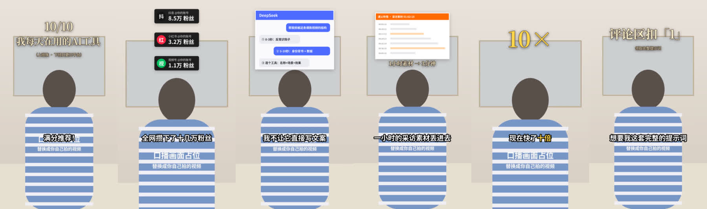

# short-video-remake

拆解一条爆款短视频的结构，改写成中文分镜脚本，再把你拍好的口播视频自动包装成竖屏成片。

适合会拍、不会做后期的个人创作者和摄影师：你负责录口播和截图，标题、数据卡片、工具图标、截图小窗、大字、推镜、字幕和音效都由脚本自动按字幕时间加上。



<p align="center"></p>

完整演示视频：[examples/demo/demo_output.mp4](examples/demo/demo_output.mp4)（人物是占位画面，替换成你自己的口播即可）

## 两种用法

### 用法一：作为 Claude Skill（推荐）

在 Claude 桌面版里安装 [`dist/short-video-remake.skill`](dist/short-video-remake.skill)（点文件卡片上的 Save skill），或者把整个仓库作为 skill 目录放进 Claude Code 的 `~/.claude/skills/`。

之后在对话里：

1. 上传参考视频（mp4），说「拆解这条视频，新主题是 xxx」。Claude 会输出拆解表、爆点分析、中文分镜脚本、补拍清单和 SRT 草稿。
2. 你照着脚本录口播，用剪映「识别字幕」导出 SRT。
3. 把口播视频、SRT、截图/录屏/头像发给 Claude，说「帮我出片」。Claude 会写好 `timeline.json`、渲染、检查画面，然后把成片给你。

### 用法二：直接命令行

```bash
pip install -r requirements.txt     # 另需安装 ffmpeg
cd examples/demo
python ../../scripts/render.py timeline.json --stills events   # 导出每个包装元素的静帧，先检查
python ../../scripts/render.py timeline.json --preview         # 半分辨率预览
python ../../scripts/render.py timeline.json                   # 正式成片 1080x1920
```

66 秒的视频在普通笔记本上约 40 秒渲染完。

## timeline.json 示例

事件用字幕里的关键词定位，不用手算时间：

```json
{
  "video": "talk.mp4",
  "srt": "talk.srt",
  "highlight": ["十倍", "扣一"],
  "style": { "auto_punch": {"every_cues": 2, "scale": 1.12} },
  "events": [
    {"type": "title", "start": 0, "lines": ["10/10", "我每天在用的AI工具"], "until": "全网"},
    {"type": "tool",  "cue": "DeepSeek", "name": "DeepSeek", "icon": "icons/deepseek.png", "until": "我不让它"},
    {"type": "pip",   "cue": "我不让它", "image": "shots/chat.png", "until": "第二个"},
    {"type": "bigtext", "cue": "快了", "text": "10×", "size": 200}
  ]
}
```

全部字段见 [references/timeline_schema.md](references/timeline_schema.md)。

## 支持的包装效果

| 效果 | type |
|---|---|
| 顶部大字标题 / 结尾引导 | `title` |
| 粉丝数据卡片，依次滑入 | `badges` |
| App 图标 + 工具名，弹出 | `tool` |
| 白边截图小窗（长图自动滚动、可放录屏） | `pip` |
| 大字数字 | `bigtext` |
| 推镜 / 切景别（单机位模拟双机位） | `zoom` 或 `style.auto_punch` |
| 闪白转场 | `flash` |
| 逐句字幕 + 关键词高亮 | 读取 SRT 自动生成 |
| BGM，人声出现时自动压低 | `style.bgm` |

音效（whoosh / pop / ding / click）由程序合成，没有版权问题。

做不到的：多段素材剪拼、去气口、调色、抠像、复杂关键帧动画。这些建议先在剪映里处理（比如用「智能剪口播」），导出一条完整口播后再交给本工具。

## 拍摄建议

竖屏拍摄，人物放在画面下方 2/3，头顶留出约 1/3 空白给标题和图标。用领夹麦收音。包装压住脸时，调 `style.top_y` 或单个事件的 `y_offset`。

## 目录

```
SKILL.md                    Claude 读取的流程说明
scripts/render.py           渲染入口
scripts/rv_layers.py        各类包装元素与动画
scripts/rv_common.py        配置、字体、绘图工具
references/timeline_schema.md
assets/                     示例 timeline 和字幕
examples/demo/              可直接运行的演示（占位素材）
dist/short-video-remake.skill
```

## 依赖

Python 3.9+、ffmpeg、numpy、opencv-python、pillow。中文字体会自动查找 Noto CJK / 苹方 / 微软雅黑，也可以在 `style.fonts` 里指定。

## 说明

本工具用于学习爆款视频的结构和手法。请使用你自己拍摄的素材，不要搬运他人的画面、文案和音乐。

## License

[MIT](LICENSE)
